  

<h3 align="center">Shopify & Headless Commerce Specialist</h3>

  I build fast, conversion-focused Shopify stores, from custom Liquid themes to headless Hydrogen storefronts, 
  for e-commerce brands and agencies worldwide.

  
  
  
  

  
  
  
  
  
  

## 👋 About Me

I'm a Shopify and headless commerce developer based in Karachi, Pakistan. I turn Figma designs and brand ideas into fast, responsive online stores, with tracking and performance built in from the start.

- 🛍️ **Shopify** store development and customization
- 🧩 **Custom Liquid** sections and themes
- ⚡ **Headless commerce** with Shopify Hydrogen and React
- 🌐 **WordPress & Elementor** websites
- 📈 Speed optimization, responsive layouts and **tracking setup**

## 🧰 Services

| | Service | What you get |
|:-:|---|---|
| 🛍️ | **Shopify Store Development** | Complete store setup, from structure and homepage to product pages and launch |
| 🧩 | **Custom Liquid Sections & Theme Customization** | Tailor-made sections and theme changes that match your brand and design |
| ⚡ | **Shopify Hydrogen / Headless Commerce** | A React-based custom storefront with full control over design and experience |
| 🌐 | **WordPress & Elementor Development** | Clean, responsive business and agency websites |
| 🚀 | **Speed & Performance Optimization** | Faster load times and better Core Web Vitals |
| 📊 | **Analytics, Pixel & UTM Tracking Setup** | Google Tag Manager and campaign parameters (UTM, fbclid, gclid) preserved across platforms |

## 🚀 Featured Work

| Project | Type | Stack | What I built | Live site |
|---|---|---|---|---|
| **Doctor Ibrahim** | Shopify store | Shopify, Liquid | Complete store built from the ground up: custom Liquid sections, homepage and storefront architecture, concept to launch | [doctoribrahim.com](https://doctoribrahim.com) |
| **Allbirds** | Headless storefront | Shopify Hydrogen, React | **[ADD: your role, e.g. collection page, product page, cart]** | [allbirds.com](https://www.allbirds.com) |
| **Champions Gloves** | UK bulk-buying store | Shopify | Store for disposable gloves and hygiene supplies, with "build your set" pages and size selectors | [championsgloves.com](https://championsgloves.com) |
| **Beauty of Renforcer** | Beauty e-commerce | Shopify, Liquid | Custom Liquid theme with responsive layouts and on-brand presentation | [beautyofrenforcer.com](https://beautyofrenforcer.com) |
| **Renforcer USA** | Product website | HTML, CSS, JavaScript | Premium dark-and-gold website for a natural honey wellness brand | [renforcerusa.com](https://renforcerusa.com) |
| **The Skin Studio** | Clinic website | **[ADD: platform]** | Boutique skin clinic website with treatments, FAQs, testimonials and a consultation booking form | [theskinstudio.webliz.co.uk](https://theskinstudio.webliz.co.uk) |
| **TrackPad** | Agency website | WordPress, Elementor | Conversion-focused website for a digital marketing agency, with services and case studies | [track-pad.com](https://track-pad.com) |

> More details in my [portfolio website](https://batmanwillarrive-lang.github.io/RaoTalha-Developer/).

## 🔍 Case Studies

### 1. Doctor Ibrahim: Shopify store, concept to launch
- **Overview:** A complete Shopify store built from the ground up.
- **Business challenge:** **[ADD: the client's goal or problem]**
- **My solution:** Custom Liquid sections, the homepage build and the storefront architecture, taken from concept to launch.
- **Technologies:** Shopify, Liquid
- **Outcome:** **[ADD: a verified result, only if you have one]**
- 🔗 [doctoribrahim.com](https://doctoribrahim.com)

### 2. Allbirds: headless storefront with Hydrogen
- **Overview:** A headless storefront built on Shopify Hydrogen.
- **Business challenge:** **[ADD]**
- **My solution:** **[ADD: the pages and components you built]**
- **Technologies:** Shopify Hydrogen, React
- **Outcome:** **[ADD: a verified result, only if you have one]**
- 🔗 [allbirds.com](https://www.allbirds.com)

### 3. Champions Gloves: bulk-buying store for the UK market
- **Overview:** An online store for disposable gloves and hygiene supplies in the UK.
- **Business challenge:** Customers buy in bulk, so the shopping flow had to make choosing sizes and quantities easy.
- **My solution:** "Build your set" pages and size selectors designed around bulk buying.
- **Technologies:** Shopify
- **Outcome:** **[ADD: a verified result, only if you have one]**
- 🔗 [championsgloves.com](https://championsgloves.com)

## 💻 Tech Stack

**Core expertise**

  
  
  
  

| Category | Technologies |
|---|---|
| **E-commerce** |    |
| **Frontend** |      |
| **CMS & Builders** |   |
| **Tracking & Analytics** |   |
| **Dev Tools** |    |

## 🔄 How I Work

1. **Discovery & Requirements:** understanding your business, goals and audience
2. **Planning & Structure:** mapping the site structure from your Figma designs or brand references
3. **Design & Development:** mobile-first, clean, conversion-focused builds
4. **Testing & Optimization:** responsive checks, speed tuning and tracking verification
5. **Delivery & Support:** launch, handover and follow-up support

## 📬 Let's Work Together

<h3 align="center">Have a Shopify project in mind? Let's build something great.</h3>

  
  

  <a href="https://batmanwillarrive-lang.github.io/RaoTalha-Developer/">Portfolio</a> ·
  <a href="https://www.linkedin.com/in/rao-talha-imam/">LinkedIn</a> ·
  📍 Karachi, Pakistan · Available worldwide

